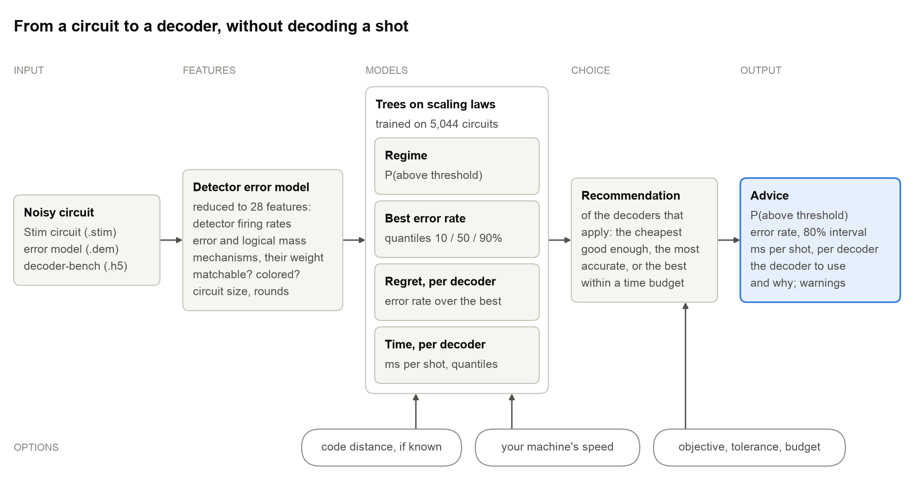
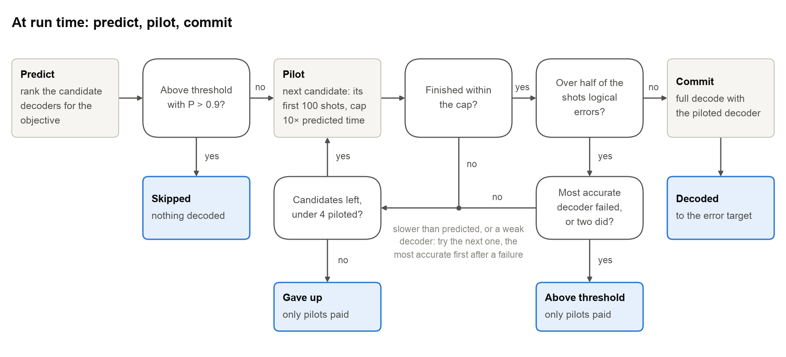
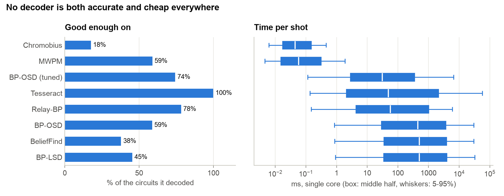
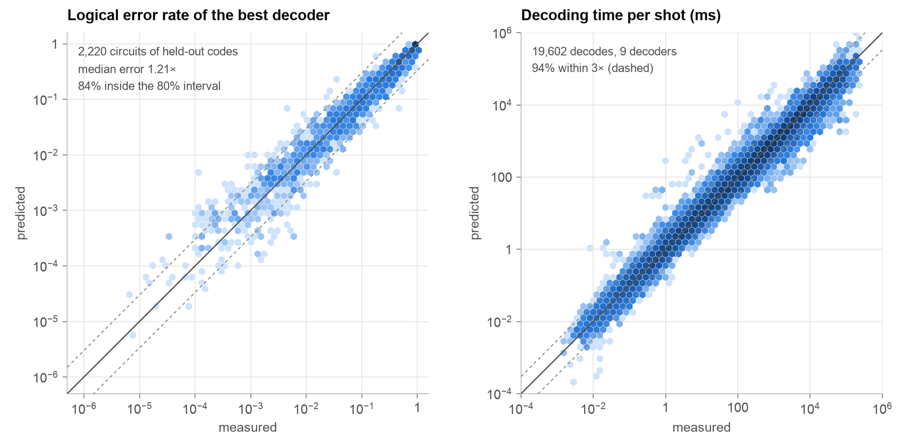
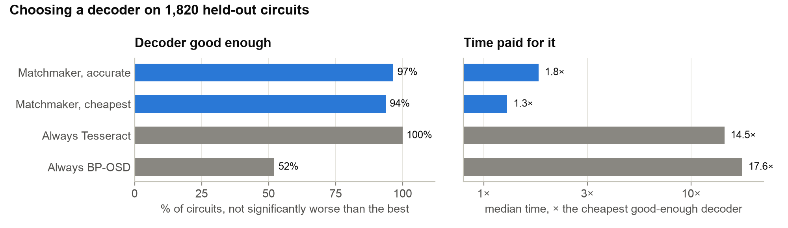
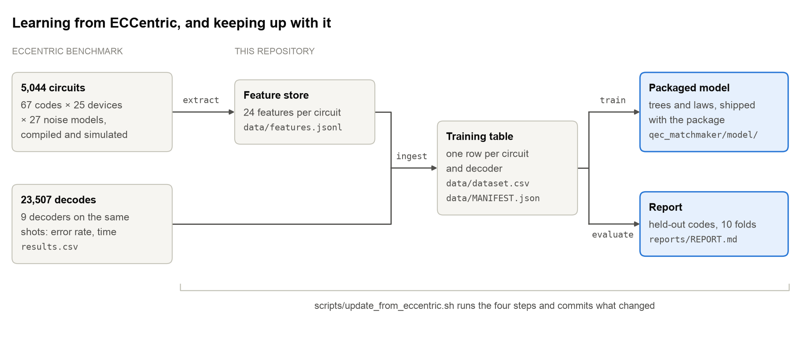

# qec-matchmaker

**Pick a decoder before you decode.**

Matchmaker reads a noisy quantum error correction circuit and tells you, in seconds and without decoding
a single shot, whether it is below threshold, roughly what its logical error rate will be, how long each
decoder will take, and which decoder to use.

> [!NOTE]
> **Working prototype, v0.1.0.** The packaged model is trained on 5,624 circuits and 33,487 measured
> decodes from the [ECCentric](https://github.com/TUM-DSE/eccentric) benchmark. MIT licensed.

## Quick start

```bash
pip install -e .
qec-matchmaker advise circuit.stim
```

```
$ qec-matchmaker advise surface_d5_p0.001.stim --distance 5
above threshold: 0%
logical error rate (best decoder): 1.00e-04 (80% interval 5.5e-05 - 3.2e-04)
recommended decoder: tesseract (cheapest (0.556 ms per shot) of the decoders predicted within 1.25x of the lowest LER (0.0001); its predicted LER is 0.0001)

    decoder  applicable      LER  ms/shot
       mwpm        True 0.000183  0.00685
bposd_tuned        True 0.000125    0.894
   relay_bp        True 0.000128    0.614
  tesseract        True   0.0001    0.556
       ...
```

From Python:

```python
import stim
from qec_matchmaker.api import advise

advice = advise(stim.Circuit.from_file("circuit.stim"), objective="accurate", code_distance=5)
advice.decoder                     # "tesseract"
advice.above_threshold             # probability
advice.ler                         # (q10, q50, q90) of the best decoder's logical error rate
advice.time_per_shot_ms            # {decoder: ms}
advice.expected_cost(errors=100)   # shots and core-hours per decoder
```

| Option | |
|---|---|
| `--objective cheapest` (default) | the cheapest decoder predicted within 1.25× of the most accurate, with 80% confidence |
| `--objective accurate` | the decoder with the lowest predicted logical error rate |
| `--objective budget --budget-ms 1 [--per-round]` | the most accurate decoder within a time budget |
| `--distance 11` | the code distance, if you know it: better predictions beyond the training data |
| `qec-matchmaker advise trace.h5` | a [decoder-bench](https://github.com/satvikmaurya/decoder-bench) trace instead of a circuit |
| `qec-matchmaker features circuit.stim` | the features the models see |

Times are for one core of the machine ECCentric ran on; `qec_matchmaker.calibrate` measures speed factors
for yours (`--calibration`). Add `[decoder-bench]` to the install to read decoder-bench traces, `[test]` for
the tests.

## How it works

<picture>
  <source media="(prefers-color-scheme: dark)" srcset="docs/figures/overview-dark.png">
  
</picture>

1. **Features.** From the circuit's detector error model: how often each detector fires, the total and the
   logical error mass, the number and weight of the error mechanisms, whether errors decompose into edges
   (matching) or carry color annotations (Chromobius), and the circuit's size. Routing, remote couplers and
   device noise all show up here, so the models apply to codes and devices they have never seen; they never
   see a code's name.
2. **Models.** Gradient-boosted trees predict the probability of being above threshold, quantiles of the best
   logical error rate, each decoder's error rate relative to the best, and each decoder's time per shot. The
   error-rate and time trees sit on top of scaling laws, so larger or quieter circuits than any in training
   are not predicted at the edge of the training data.
3. **Recommendation.** Among the decoders that apply: the most accurate, the cheapest within a tolerance of
   the most accurate, or the most accurate within a time budget.

`qec_matchmaker.runtime.execute` then decodes with the predictions checked as it goes: it skips a circuit
predicted above threshold, pilots the recommended decoder on its first 100 shots under a time cap, moves to the
next candidate if the pilot is too slow or fails, and commits to the full decode only once a pilot passes.

<picture>
  <source media="(prefers-color-scheme: dark)" srcset="docs/figures/runtime-dark.png">
  
</picture>

## The dataset

Matchmaker learns from [ECCentric](https://github.com/TUM-DSE/eccentric), an end-to-end benchmark that
compiles QEC codes onto real and projected quantum devices, simulates them under each device's noise, and
decodes every circuit with several decoders on the same shots.

| | |
|---|---|
| Circuits | 5,624: 5,044 memory experiments (3,194 in the Z basis, 1,850 in the X basis) and 580 logical operations (surgery measurements, transversal CNOT, lattice surgery), 8 to 9,405 detectors |
| Codes | 70 codes from 26 families: surface, color, heavy-hex, Floquet, bivariate bicycle, hypergraph and lifted product, quantum Tanner, ... |
| Devices | 25: IBM Heron, Flamingo, Loon and the bicycle module (one and several QPUs), Google Willow, Quantinuum Apollo, Harvard/MIT and Infleqtion neutral atoms, and ideal grid, all-to-all and cube layouts |
| Noise | 27 models: each device's own, scaled versions of them, and standard circuit noise |
| Decoders | 11: MWPM, MWPF, BP-OSD (paper and tuned settings), BP-LSD, BeliefFind, Relay-BP, Tesseract, Chromobius, GARI, GARI++ (ECCentric's beta reimplementation) |
| Decodes | 34,798, from 2.4 billion shots |

Every decoder trades accuracy against time differently, and none wins everywhere. Tesseract is the most
accurate wherever it finishes, but it is among the slowest and timed out on 256 of the largest circuits;
matching and Chromobius are fast but apply to few codes and lose accuracy on compiled circuits:

<picture>
  <source media="(prefers-color-scheme: dark)" srcset="docs/figures/decoders-dark.png">
  
</picture>

The training table is [data/dataset.csv](data/dataset.csv) (one row per circuit and decoder, with the features)
and its provenance [data/MANIFEST.json](data/MANIFEST.json) (ECCentric commit and file hashes).

## How good it is

Every number below is for codes held out of training (10 folds over the 70 codes): the model never saw the
code it is predicting.

<picture>
  <source media="(prefers-color-scheme: dark)" srcset="docs/figures/accuracy-dark.png">
  
</picture>

<picture>
  <source media="(prefers-color-scheme: dark)" srcset="docs/figures/choice-dark.png">
  
</picture>

Threshold regime: 97% correct. Matchmaker's "accurate" choice is as good as always running Tesseract at a
fraction of its time; "cheapest" trades a few percent of accuracy for the cheapest decoder.

Replaying ECCentric's whole sweep with Matchmaker deciding what to decode and with which decoder
([experiments/END_TO_END.md](experiments/END_TO_END.md)) reaches the quality of always running Tesseract (92% of circuits good enough for both) at 54% of its CPU time
and 18% of the sweep's, mostly by skipping 95% of the circuits that are above threshold. Piloting each decode on
its first 100 shots (`qec_matchmaker.runtime.execute`) then checks each prediction as it runs: 93% good enough at
43% of always-Tesseract's CPU time (92% at 38% with the cheapest objective), with 99% of the above-threshold
circuits caught.

More: the full report ([reports/REPORT.md](reports/REPORT.md)), whole code families, devices and noise models
held out ([experiments/GENERALIZATION.md](experiments/GENERALIZATION.md)), circuits beyond the training range
([experiments/EXTRAPOLATION.md](experiments/EXTRAPOLATION.md)), logical operations predicted from memory
experiments ([experiments/OPERATIONS.md](experiments/OPERATIONS.md)), and circuits from outside ECCentric, Stim's
generators and decoder-bench ([experiments/EXTERNAL.md](experiments/EXTERNAL.md): error rate within 1.1×,
time within 3× for 87%).

## Limitations

- Timings are for single-core software decoders, including the decoder's construction; FPGA and ASIC decoders
  are not modelled.
- Most of the training data are memory experiments. Predicted from memory alone, logical operations keep their decode times (92% within 3x) but surgery measurements' error rates are off by about 0.5 decades ([experiments/OPERATIONS.md](experiments/OPERATIONS.md)); the packaged model now also trains on the 580 operation circuits, but a new kind of gadget is an extrapolation.
- Predicted error rates are for planning, not for publication. Beyond the training data the 80% intervals are
  too narrow, and a noise model unlike any in training (atom loss, for example) can mislead the time
  predictions. `advise` warns when a circuit is outside the training range.

## Keeping up with ECCentric

```bash
scripts/update_from_eccentric.sh          # MM_PUSH=1 to push; see the script for settings
```

extracts the features of new circuits on the cluster that holds ECCentric's runs, rebuilds the training table
from ECCentric's sweep table, retrains, re-evaluates, and commits the data, the packaged model and the report.

<picture>
  <source media="(prefers-color-scheme: dark)" srcset="docs/figures/training-dark.png">
  
</picture>

`scripts/make_figures.py` redraws the figures and `scripts/make_diagrams.py` the diagrams. Design notes: [docs/DESIGN.md](docs/DESIGN.md).

## License and citation

MIT ([LICENSE](LICENSE)). If you use Matchmaker in your research, please cite it, and ECCentric, whose
measurements train it ([CITATION.cff](CITATION.cff), which GitHub's "Cite this repository" button reads):

```bibtex
@software{giortamis2026matchmaker,
  title  = {qec-matchmaker: pick a decoder before you decode},
  author = {Giortamis, Emmanouil},
  year   = {2026},
  url    = {https://github.com/manosgior/qec-matchmaker}
}

@inproceedings{swierkowska2026eccentric,
  title     = {ECCentric: An Empirical Analysis of Quantum Error Correction Codes},
  author    = {{\'S}wierkowska, Aleksandra and Pflieger, Jannik and Giortamis, Emmanouil and Bhatotia, Pramod},
  booktitle = {Proceedings of the ACM SIGMETRICS Conference (SIGMETRICS'26)},
  year      = {2026},
  note      = {arXiv:2511.01062}
}
```
